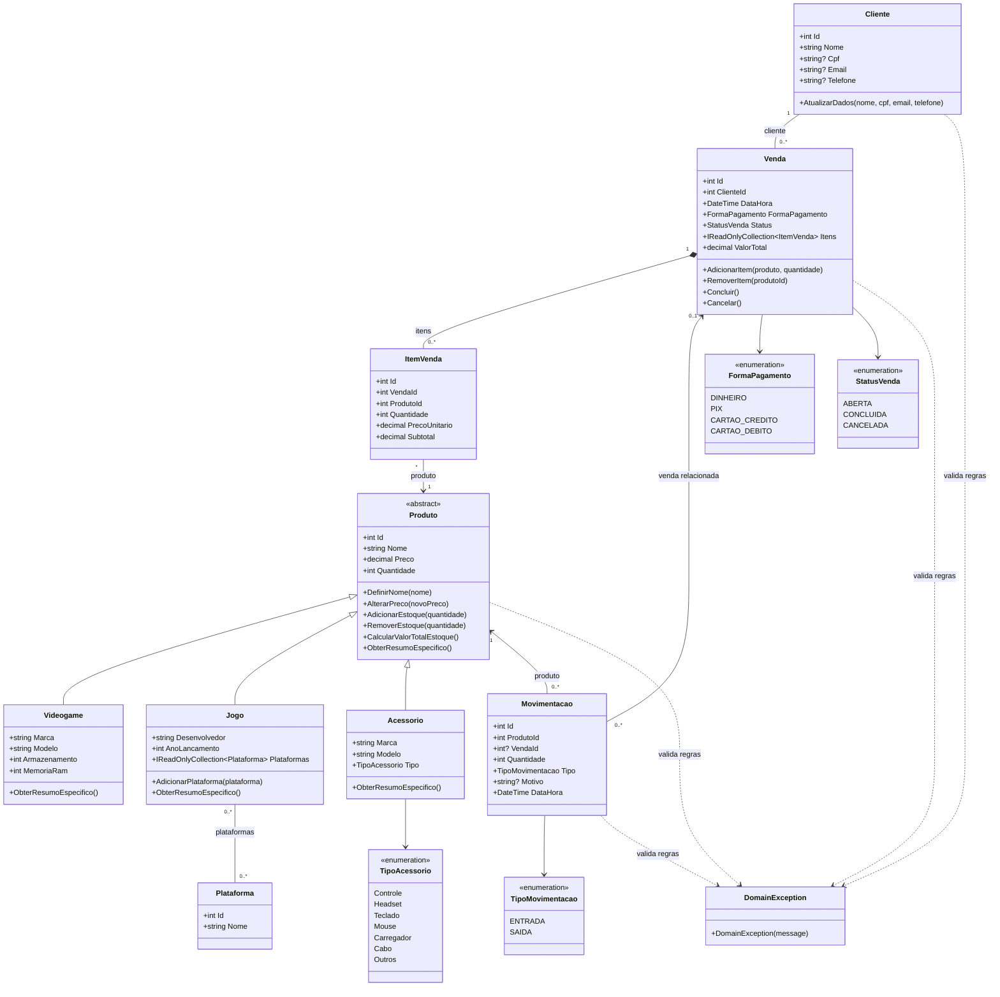

# GameStore

O GameStore é uma aplicação web para gerenciamento de uma loja especializada em videogames, jogos e acessórios. O sistema organiza o catálogo, acompanha as quantidades em estoque, mantém os dados de clientes e registra vendas. O projeto também demonstra conceitos de Programação Orientada a Objetos e persistência de dados em banco relacional.

## Integrantes

- Eduardo Henrique Vianna Silva — RA: `2840482511001`
- Fellipe Faria — RA: `2840482511023`
- Igor Pereira Alvez — RA: `2840482511040`
- Tiago Sanches Polo — RA: `2840482511016`

## Funcionalidades

- **Produtos:** cadastro de videogames, jogos e acessórios; listagem do catálogo com especificações, estoque e preço; edição e exclusão.
- **Clientes:** cadastro, listagem e edição de nome, CPF, e-mail e telefone.
- **Estoque:** registro e consulta de movimentações de entrada e saída. As quantidades são atualizadas pelas movimentações e pelas vendas.
- **Vendas:** registro de venda para um cliente, com produto, quantidade e forma de pagamento; consulta do histórico, dos itens, do status e do total de vendas concluídas.
- **Validações de domínio:** regras para dados e operações, incluindo preço e quantidade não negativos, quantidade de movimentação positiva e verificação de estoque disponível para venda.

## Conceitos de POO no domínio

- **Abstração e herança:** `Produto` é uma classe abstrata. `Videogame`, `Jogo` e `Acessorio` herdam seus dados e comportamentos comuns e definem suas especificações.
- **Encapsulamento:** propriedades e alterações de estado são protegidas por acessores e métodos do domínio, como `AdicionarEstoque`, `RemoverEstoque` e `AtualizarDados`.
- **Polimorfismo:** os produtos implementam `ObterResumoEspecifico` para apresentar os detalhes próprios de cada tipo.
- **Composição e associações:** uma `Venda` reúne `ItemVenda`; itens referenciam produtos, e jogos podem estar associados a várias `Plataforma`.
- **Enums e exceção de domínio:** enums representam tipos de acessório, formas de pagamento, status da venda e tipos de movimentação. `DomainException` comunica violações das regras do domínio.

## Diagrama de classes UML



## Tecnologias

- ASP.NET Core MVC com Razor Views
- C# e .NET 10 (`net10.0`)
- SQLite por meio do pacote `Microsoft.Data.Sqlite`
- Dapper para acesso a dados

## Configuração e execução

### Pré-requisitos

- .NET SDK 10 instalado.
- Terminal aberto na raiz do projeto, onde está `ProjetoPOO.csproj`.

### Connection String e banco de dados

Em `appsettings.json`, a conexão usada pela aplicação é `ConnectionStrings:DefaultConnection`:

```json
"ConnectionStrings": {
  "DefaultConnection": "Data Source=gamestore.db"
}
```

O valor padrão usa SQLite e aponta para `gamestore.db`. Ajuste o `Data Source` nessa configuração para mudar o arquivo do banco. `appsettings.Development.json` contém apenas configurações de log e não substitui a connection string padrão.

Na inicialização, `Program.cs` chama `DbInitializer`, que verifica se já existe a tabela `Produtos`. Se não existir, executa `Database/Script.sql`, que cria as tabelas, índices, gatilhos e insere dados de exemplo. Portanto, em uma instalação nova não é necessário executar o script manualmente. Se a tabela `Produtos` já existir, o inicializador não executa o script novamente.

### Restaurar, compilar e iniciar

No terminal, a partir da raiz do projeto, execute:

```powershell
dotnet restore
dotnet build
dotnet run
```

Quando a aplicação iniciar, o terminal exibirá os endereços locais de escuta, normalmente no formato `http://localhost:<porta>` e/ou `https://localhost:<porta>`. Abra no navegador o endereço informado pelo próprio `dotnet run`.

## Navegação da aplicação

O menu principal dá acesso às páginas **Produtos**, **Clientes**, **Estoque** e **Vendas**. A rota inicial da aplicação também abre o catálogo de produtos.
